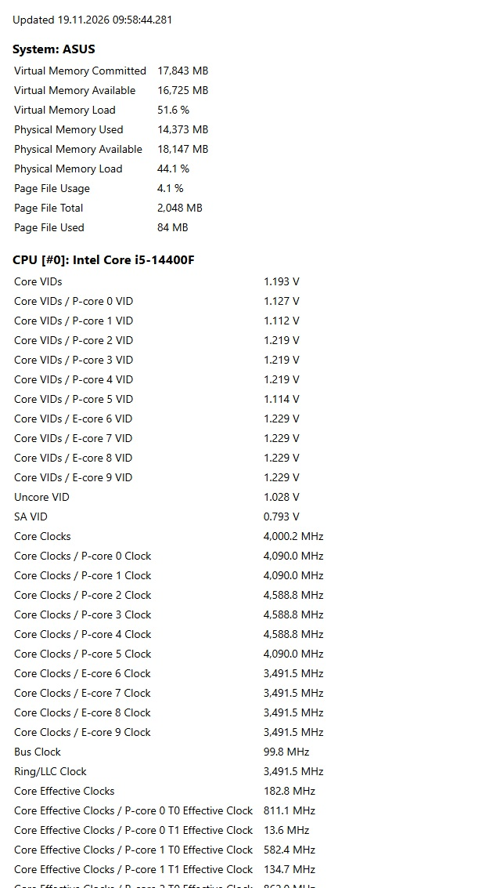
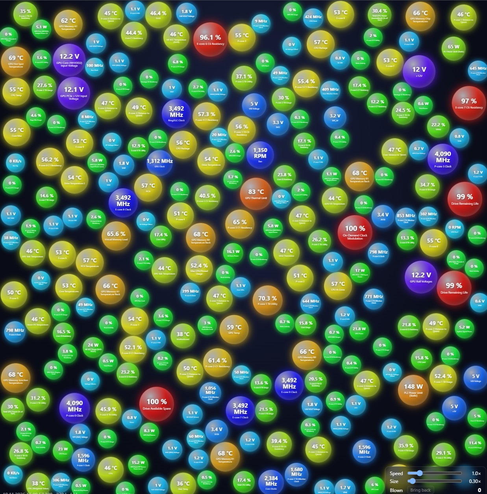
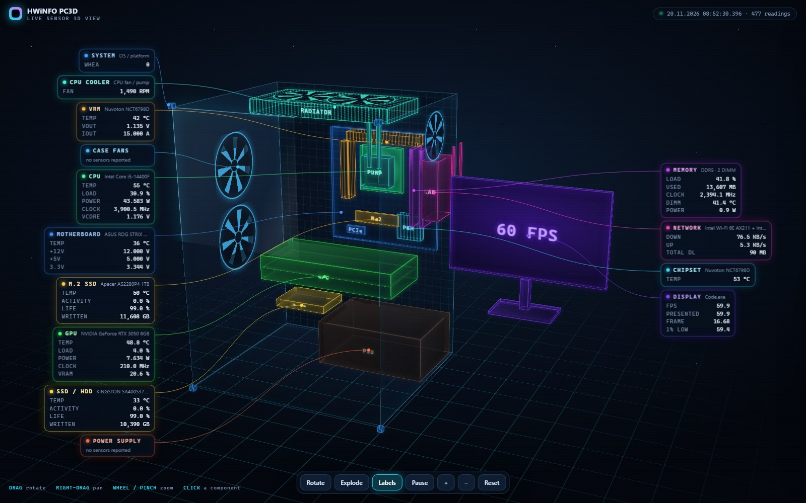
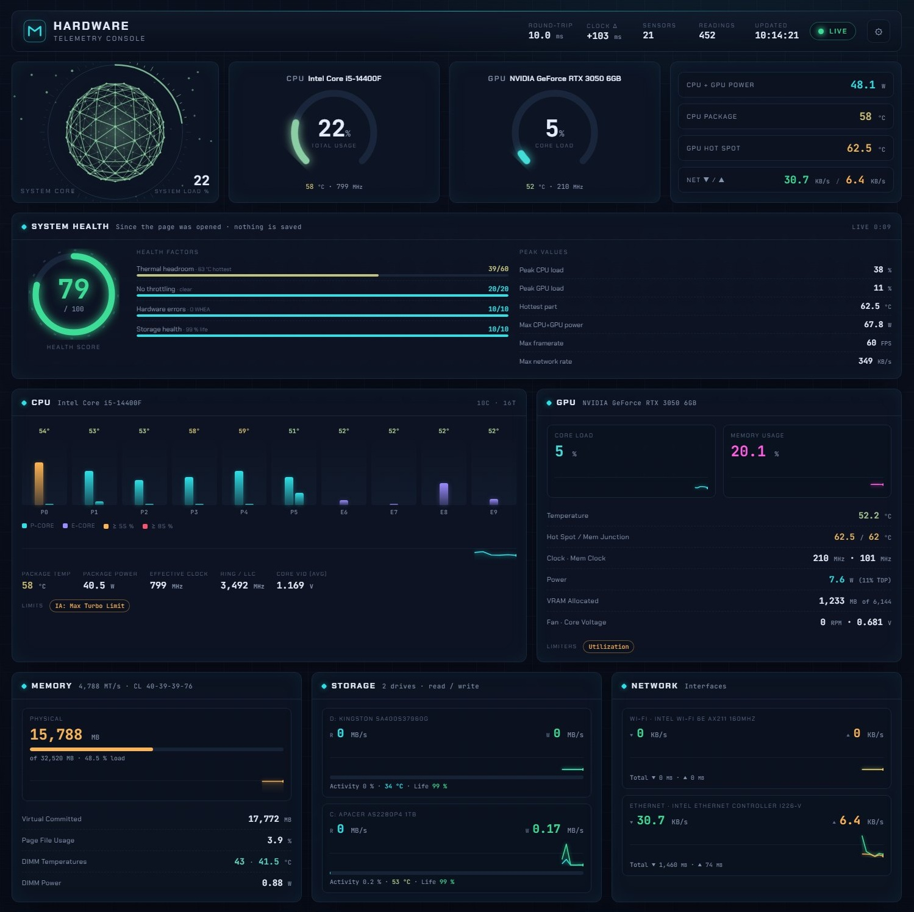
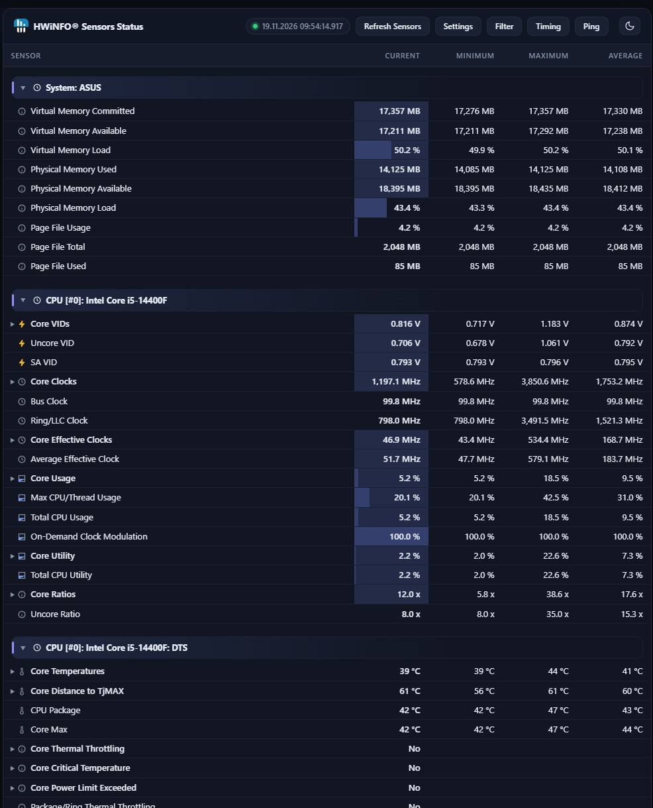

# HWiNFO REST API — Dashboards

Example dashboards built on the **HWiNFO REST API**. Each one is a single, self-contained HTML file. Click a name for its full description.

| Dashboard | Description | Preview |
|---|---|---|
| [**Simple Example**](simple_example/) | A minimal reference page that lists every sensor reading with its unit. The best starting point for your own dashboard. |  |
| [**Bubbles**](bubbles/) | A playful view where every reading is a floating, colour-coded bubble you can pop. |  |
| [**PC3D**](pc3d/) | A 3D model of your PC where every component shows its live readings. Rotate it, explode it, and click a part for details. |  |
| [**Telemetry Console**](telemetry_console/) | A futuristic console that shows the whole PC on one page: CPU cores, GPU, memory, drives, network, FPS, voltage rails and a thermal map. |  |
| [**Built-in Dashboard**](hwinfo_builtin/) | The full dashboard shipped inside HWiNFO, with live statistics, a sensor filter editor and timing. |  |

## Add your own

Everyone is welcome to contribute. Add a folder with your `.html` page, a `Readme.md` and a `Screenshot.jpg`, then add a row to the table above.

See also: [API guide (PDF)](../docs/HWiNFO_REST_API.pdf) · [API description for AI agents](../AI/HWiNFO_REST_API_SKILL.md)
