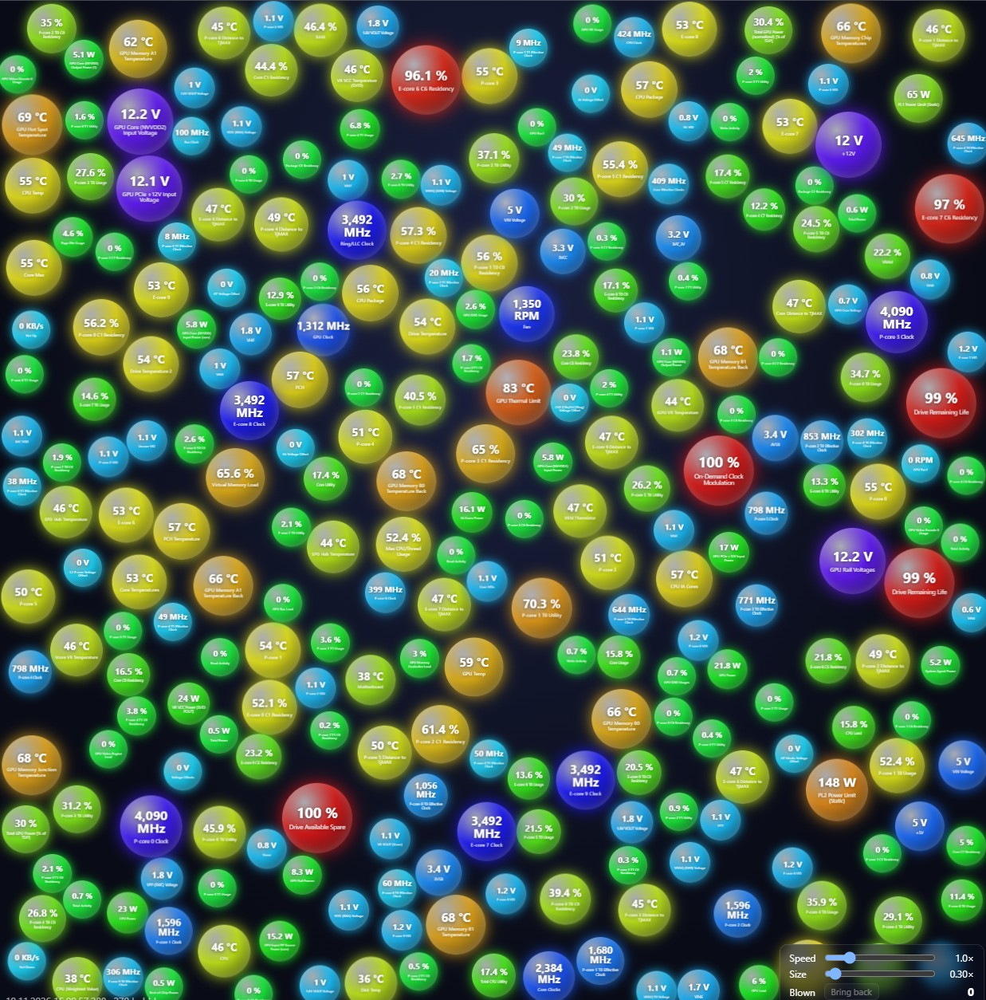

# Bubbles

📄 [`bubbles.html`](bubbles.html), a single self-contained page with no libraries

An amusing way to watch your hardware. Every numeric sensor reading becomes a glowing bubble that drifts around the screen. Its colour and size change with the value, and you can pop bubbles with a double-click.

## What a bubble means

- **Text**: the value with its unit (large) and the reading name (small).
- **Colour** shows how high the value is compared with a typical maximum:
  - **green → yellow → red** for readings where high is bad: temperatures, load (`%`), power (`W`);
  - **blue → purple** for readings where high is normal: clocks, fans, voltages, network rates, others.
- **Size** grows with the value (from 70 % to 130 % of the base size), scaled by the **Size** slider.

## Which readings are shown

Readings are taken in priority order until the bubbles fill about half of the window:

1. **Key readings**, picked by name: CPU Temp / Load / Power / Clock, GPU Temp / Load / Power / Clock, VRAM, RAM, Disk Temp, Fan, Net Down / Up. They work for Intel, AMD, NVIDIA and Radeon names.
2. **Other readings with common units**: `°C`, `%`, `W`, `RPM`, `V`, `MHz`, `MB/s`, `KB/s`.
3. **Every other numeric reading.** Text values such as `Yes`/`No` are skipped.

So smaller bubbles mean more bubbles. At a small size, all numeric readings fit on screen. When you shrink the window or enlarge the bubbles, the ones that no longer fit **pop**. Readings that disappear from the data simply vanish.

## Controls

The panel in the bottom-right corner:

| Control | Range | Effect |
|---|---|---|
| **Speed** | 0 – 5× | Movement speed. 0 stops the bubbles. |
| **Size** | 0.15 – 3× | Bubble size, and so the number of bubbles on screen. |
| **Blown** | counter | How many bubbles you popped in this session. |
| **Bring back (N)** | button | Shows the bubbles you popped again. |

- **Double-click a bubble** to pop it: a flash, shock rings, droplets and a "+1". The bubble stays hidden until *Bring back*, and the freed space is refilled with the next readings.
- The bottom-left corner shows the server timestamp and the number of readings.

## URL parameters

| Parameter | Example | Meaning |
|---|---|---|
| `server` | `?server=192.168.1.10:8080` | Server address (`http://` is added when no scheme is given). |
| `bubbles` | `?bubbles=40` | Maximum number of bubbles (default: no limit). |
| `speed` | `?speed=0.5` | Initial Speed slider value. |
| `size` | `?size=0.4` | Initial Size slider value. |

Nothing is stored in the browser. Settings last only until the page is reloaded.

## Running it

- **Served by the server**: same origin, no parameters needed.
- **Opened from disk** (`file://`): the page connects to `http://127.0.0.1:8080` (start the server with `--http`), or to the address given with `?server=`.

## API used

| Endpoint | When | Purpose |
|---|---|---|
| `GET /api/sensors/sdb` | once at start (optional) | units of the readings. Without it, units are guessed from the reading type. |
| `GET /api/sensors/read` | every 1 s | current values |

A missing or unsupported `Version` stops polling and shows an error.

## Performance

Changes from the Size slider and window resizing are applied at most once per animation frame. Only a few bubbles per update get the full pop animation, and the rest just fade out, so dragging the Size slider stays smooth even with hundreds of bubbles.
