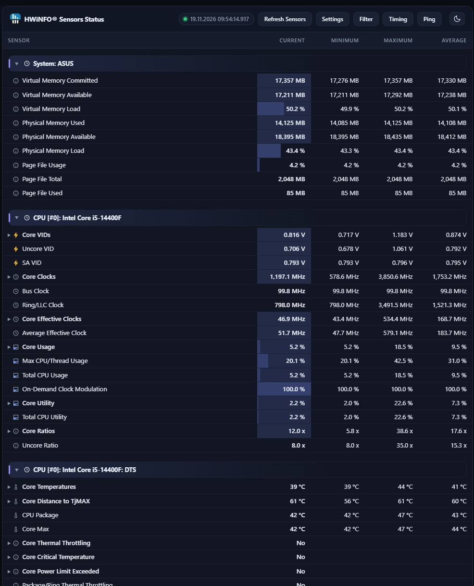

# Built-in Dashboard

📄 [`HWiNFO_builtin_dashboard.html`](HWiNFO_builtin_dashboard.html), a single self-contained page with no libraries

This dashboard is built directly into **HWiNFO**. It is served at the root of the REST API server, so you can open it from the link shown when the server starts. It is the most complete example: a live sensor table with statistics, a sensor filter editor, timing statistics and a connection test.

## Toolbar

| Item | Function |
|---|---|
| **Status** (green dot + time) | Server timestamp of the last reading, or the error. |
| **Refresh Sensors** | Reads `/api/sensors/read` once, rebuilds the list and checks that every reading has a valid `Value`. The result is shown in the status. |
| **Settings** | Polling options (see below). |
| **Filter** | Opens the sensor filter editor. |
| **Timing** | Opens the request and response timing statistics. |
| **Ping** | Checks the connection and shows the round-trip time. |
| ☾ / ☀ | Switches between the light and dark theme. The default follows the OS setting. |

## Sensor table

- Columns: **Sensor · Current · Minimum · Maximum · Average**. Min/Max/Avg are collected since the page was opened.
- **Sensors** are collapsible sections. **Groups** of readings (for example *Core VIDs*, *Core Clocks*, *Core Temperatures*) are collapsed by default and open with the ▸ arrow.
- **An icon per reading type**: temperature, voltage, fan, current, power, clock, usage, other.
- **Units and tooltips** come from the sensor database (`/api/sensors/sdb`). Hover over a reading to see its tooltip.
- **`%` bars**: `%` readings are drawn as a load bar in the Current column.
- **Change highlight**: the Current cell is tinted briefly when its value changes.
- **Text values** (`Yes`/`No`, for example the throttling flags) have no Min/Max/Avg.

## Settings

| Option | Default | Meaning |
|---|---|---|
| **Poll** | on | Automatic refresh. When it is off, only *Refresh Sensors* updates the data. |
| **Show % bars** | on | Load bars for `%` readings. |
| **Polling period (ms)** | 2000 | Refresh interval (minimum 50). The rate is fixed, and late responses are dropped. |

Settings are **not saved**: the page stores nothing in the browser (no cookies, no localStorage).

## Filter (sensor database editor)

Loads the sensor database from `/api/sensors/sdb` and lets you choose what the server reports:

- **A tree of sensors, groups and readings** with the **Type** column and three flags per item: **Hide**, **Monitor**, **Log**. Turning *Hide* on also turns *Monitor* off.
- **Editing**: right-click menu (*Add Sensor*, *Add Group*, *Delete*). On a top-level sensor, it also offers Hide/Unhide and turning monitoring or logging on or off for everything below. Multi-select with Ctrl/Shift and delete with the Delete key.
- **Expand all / Collapse all**, **Undo / Redo** (200 steps), **Reload**.
- **Sort by Reading Type / Name / Repeating Words**: keep only the matching items, or remove them.
- **Apply to server**: sends the filter to `/api/sensors/filter/apply`. From then on, hidden or unmonitored readings are left out of `/api/sensors/read`.
- **Reset on server**: clears the stored filter (`/api/sensors/filter/reset`) and reloads the original database.

## Timing

Shows statistics (**Last / Min / Max / Avg / P95** over the last 200 requests) for each stage of a request:

request → read start · sensor readout · JSON build · server total · response → received · total

The client clock is synchronised with the server's clock, NTP-style, using `/api/ping` (8 pings, re-sync every 60 s, or manually with **Sync clock**). **Reset** clears the statistics.

## Mobile

On narrow screens, the sensor table turns into stacked cards (name, current value, Min/Max/Avg), and the filter table scrolls sideways.

## Running it

- **From HWiNFO**: open the link shown when the REST API server starts.
- **Opened from disk** (`file://`): the page connects to `http://127.0.0.1:8080` (start the server with `--http`).
- **Another server**: `?server=host:port`.

## API used

| Endpoint | Purpose |
|---|---|
| `GET /api/sensors/read` | current values (polled) |
| `GET /api/sensors/sdb` | units, tooltips and the filter tree |
| `GET /api/ping` | connection test and clock sync |
| `POST /api/sensors/filter/apply` | apply a filter |
| `POST /api/sensors/filter/reset` | remove the filter |
