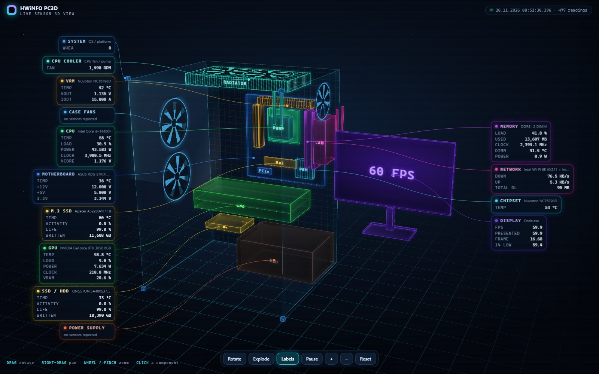
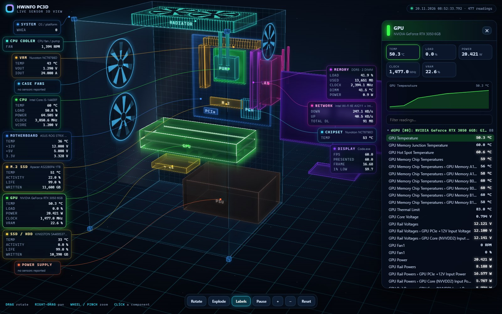

# PC3D

📄 [`hwinfo_pc3d.html`](hwinfo_pc3d.html), a single self-contained page with no libraries (pure CSS 3D)

A futuristic live 3D model of your computer: a wireframe PC case with its monitor, where every component carries its live sensor readings. Rotate, zoom and explode the model, then click a component to see all of its readings with a live chart.

## What it shows

- **A 3D model** of the case and monitor: radiator and fans, CPU with pump, memory, VRM, M.2 and PCIe slots, chipset (PCH), GPU, drives and power supply. A grid floor sits under it, and the monitor shows the current FPS.
- **HUD tags** around the model, connected to their component by a line. Each tag shows the component name, the device (for example *Intel Core i5-14400F*, *NVIDIA GeForce RTX 3050*) and its key readings:

| Component | Key readings |
|---|---|
| CPU | Temp, Load, Power, Clock, Vcore |
| GPU | Temp, Load, Power, Clock, VRAM |
| Memory | Load, Used, Clock, DIMM temp, Power |
| Motherboard | Temp, +12V, +5V, 3.3V |
| VRM | Temp, Vout, Iout |
| Chipset | Temp |
| M.2 SSD / SSD / HDD (one tag per drive) | Temp, Activity, Life, Written |
| Network | Down, Up, Total DL |
| Display | FPS, Presented, Frame time, 1 % low (from PresentMon) |
| CPU cooler, Case fans | Fan RPM |
| System | WHEA errors |
| Power supply | PSU readings, if any |

A component with no matching sensors shows *no sensors reported*.

## How readings are mapped to components

On start, the page loads the sensor database (`/api/sensors/sdb`) once and uses each reading's **sensor location** and **reading location** to place it on the right component. If the SDB is not available, it falls back to recognising sensor and reading names (CPU, GPU, S.M.A.R.T., network adapter, and so on). Values are then refreshed from `/api/sensors/read` every 2 seconds.

## Component details

Click a component (in the 3D model or its tag) to open the detail panel:

- **Headline cards** with the key readings. Click a card to chart it.
- **A live chart** of the selected reading, built from the values seen since the page was opened.
- **Filter readings…**: search box for the reading list.
- **The full list** of all readings mapped to the component, grouped by sensor. Values flash when they change. Hover a row to see its tooltip, and click a row to chart it.
- The view pans and zooms so the selected component stays visible next to the panel. Close the panel with ✕ or Esc.

## Controls

| Action | Mouse / touch | Keyboard |
|---|---|---|
| Rotate | drag | ← → ↑ ↓ |
| Pan | right-drag or Shift + drag | |
| Zoom | wheel or pinch, **+** / **−** buttons | `+` / `-` |
| Auto-rotate | **Rotate** | Space |
| Exploded view (spreads the parts apart) | **Explode** | `E` |
| Show / hide tags | **Labels** | `L` |
| Pause / resume polling | **Pause** | `P` |
| Reset the view | **Reset** | `0` |
| Close the detail panel | ✕ | Esc |

The top-right corner shows the server timestamp and the number of readings.

## Running it

- **Opened from disk** (`file://`): the page connects to `http://127.0.0.1:8080`. Start the server with `--http`.
- **Another server**: `?server=host:port` (HTTP only).
- **Served by the server**: same origin, no parameters needed.

> **HTTPS:** this version always uses `http://`, both for the default address and for `?server=`. With a server running HTTPS, the page stays on *Linking to HWiNFO server*. Start the server with `--http`, or change `BASE` at the top of the script to `https://`.

Nothing is stored in the browser: no cookies, no localStorage.

## API used

| Endpoint | When | Purpose |
|---|---|---|
| `GET /api/sensors/sdb` | once at start (optional) | sensor and reading locations, units, tooltips |
| `GET /api/sensors/read` | every 2 s | current values |

An unsupported `Version` in the data is reported as an error, and that data is not used. Data without a `Version` is accepted.
