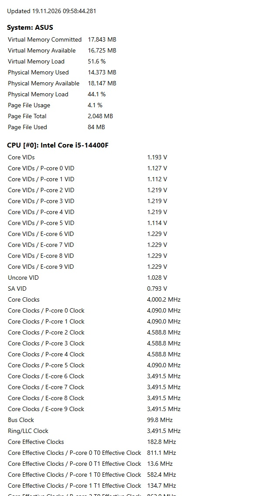

# Simple Example

📄 [`simple_dashboard.html`](simple_dashboard.html), about 100 lines of plain HTML and JavaScript, no libraries

The smallest complete dashboard for the HWiNFO REST API. It shows every sensor as a heading with a table of its readings, refreshed every 2 seconds. Use it as a template: the full code fits on one screen, and it shows everything a dashboard needs to do.



## What it shows

- A status line at the top: `Updated <timestamp>` from the server, or the error message in red.
- One section per sensor, for example *System: ASUS* or *CPU [#0]: Intel Core i5-14400F*.
- One row per reading, with its full path (`Core Clocks / P-core 0 Clock`) and its value with unit (`4,090.0 MHz`).

## How it works

| Step | Code | What happens |
|---|---|---|
| 1. Load units | `loadUnits()` | Fetches `/api/sensors/sdb` **once** and builds a map from reading path to unit. Units are not part of `/read`. If this fails, values are shown without units. |
| 2. Poll | `tick()` | Fetches `/api/sensors/read` every `POLL_MS` (2000 ms). The next call is scheduled *before* the fetch, so the rate stays fixed. |
| 3. Check version | `data.Version` | A missing or unsupported `Version` is shown as an error, and the data is not used. |
| 4. Walk the tree | `collect()` | Recursively finds every object with a `Value` at any depth. It understands both the typed layout `"<name>": {"<type>": {"Value": ..}}` and the flat layout `"<name>": {"Value": ..}`. |
| 5. Render | `render()` | Rebuilds the tables. Top-level non-object fields (timestamps, `Version`) are skipped. |
| Errors | `getJson()` | A non-200 response becomes `HTTP <status>: <error>`, using the server's JSON `error` field when there is one. |

## Configuration

Edit the constants at the top of the script:

```js
const POLL_MS = 2000;                                   // refresh period in ms
const HOST = location.protocol === 'file:'
           ? 'https://127.0.0.1:8080'                   // server address when the page is opened from disk
           : '';                                        // same origin when served by HWiNFO
```

## Running it

- **Served by the server**: no changes needed, because all requests use absolute paths (`/api/...`) on the same origin.
- **Opened from disk** (`file://`): the page connects to `https://127.0.0.1:8080`. With the default self-signed certificate, open that address in the browser once and accept the certificate. Otherwise, change `HOST`.

## API used

| Endpoint | When | Purpose |
|---|---|---|
| `GET /api/sensors/sdb` | once at start | units of the readings |
| `GET /api/sensors/read` | every 2 s | current values |

## Ideas for extending it

- Show only selected sensors (filter by the sensor name in `render()`).
- Track Min/Max/Average per reading between polls.
- Draw bars for `%` readings, or colour temperatures by value.
- Show the SDB `Tooltip` text when the mouse hovers over a reading (it is stored next to `Unit`).
