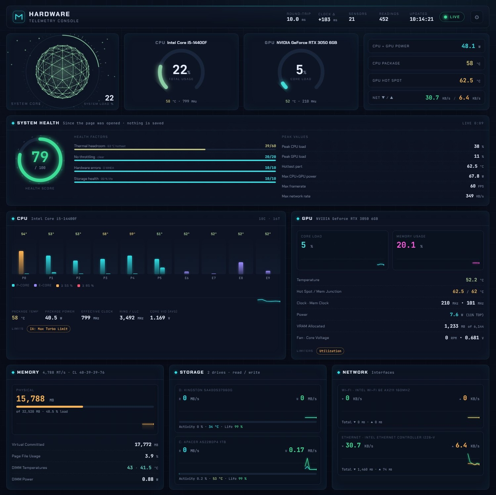

# Telemetry Console

📄 [`telemetry_console.html`](telemetry_console.html), a single self-contained page with no libraries

A dark, futuristic hardware console that shows a whole PC on one page: CPU, GPU, memory, storage, network, framerate, voltage rails and every temperature, each with live charts. It works on any machine: panels fill themselves from whatever sensors HWiNFO reports.

## Layout

### Header
Status bar showing **round-trip** time of the last request, **clock Δ** (server clock minus browser clock), the number of **sensors** and **readings**, the server time of the last **update**, and the connection state (**LIVE** / error / paused). The ⚙ button opens the settings.

### Overview
- **System core**: a rotating 3D wireframe sphere whose speed follows the overall system load.
- **CPU gauge**: total usage, with package temperature and effective clock.
- **GPU gauge**: core load, with temperature and clock.
- **Quick stats**: CPU + GPU power, CPU package temperature, GPU hot spot, and network down/up.

### System Health
- **Health score** 0–100, made up of four factors:

  | Factor | Points | Full points when |
  |---|---|---|
  | Thermal headroom | 60 | hottest part ≤ 45 °C (0 points at 95 °C) |
  | No throttling | 20 | no throttling is reported |
  | Hardware errors | 10 | 0 WHEA errors |
  | Storage health | 10 | full drive life left (0 points on a S.M.A.R.T. warning or failure) |

  If a factor has no data, the score is calculated from the factors that do.
- **Peak values** since the page was opened: CPU load, GPU load, hottest part, CPU + GPU power, framerate, network rate.
- **LIVE m:ss**: how long the page has been receiving data.

### CPU
- **Core map**: one column per core (P-cores and E-cores coloured separately), a bar per thread showing its load, and the core temperature on top. Bars turn amber at 55 % and red at 85 %.
- A load history chart, plus package temperature, package power, effective clock, ring/LLC clock and average core VID.
- **Limits**: the CPU's active power and thermal limits, for example *IA: Max Turbo Limit*.

### GPU
Core load and memory usage with history charts, plus temperature, hot spot and memory junction temperatures, core and memory clocks, power (with % of TDP), VRAM allocated, fan and core voltage. **Limiters** lists the active GPU limits, for example *Utilization* or *Power*.

### Memory
Physical memory used out of total, with a load bar and history chart. Also shows virtual memory committed, page file usage, DIMM temperatures and DIMM power. The panel header shows the memory speed and timings.

### Storage
One card per drive, with read and write rates, a history chart, and activity, temperature and remaining life from S.M.A.R.T.

### Network
One card per network adapter, with download and upload rates (automatically shown in KB/s or MB/s), a history chart, and the totals downloaded and uploaded.

### Display
Framerate from PresentMon (average FPS) with a history chart, plus average frame time, 1 % / 0.1 % lows, and GPU busy / CPU busy times. The panel header shows the application being measured.

### Rails
All voltage rails, each with its deviation from the nominal value (+12V, +5V, 3.3V, VDD, VID, and so on). Deviations are colour-coded.

### Thermal Map
Every temperature sensor as a coloured tile, grouped by device (CPU, GPU, memory, storage, board) in a fixed order. The hottest part is highlighted and named in the panel header.

## Settings (⚙)

| Setting | Options |
|---|---|
| **Server Base URL** | empty = the server that serves the page. Opened from disk, the default is `http://127.0.0.1:8080`. |
| **Poll Interval** | 0.5 / 1 / 1.5 / 2 (default) / 3 / 5 s |
| **3D Core Motion** | Auto (follows the load) / Always on / Off. Off by default when the OS asks for reduced motion. |
| **Pause / Resume** | stops or restarts polling |
| **Reset Sensor Filter** | after a confirmation, clears the sensor filter on the server, so all readings become visible again **for every client** |

Settings are **not saved**: the page stores nothing in the browser. For a fixed setup, use URL parameters:

| Parameter | Example | Meaning |
|---|---|---|
| `base` | `?base=https://PC:8080` | Server address, with scheme. |
| `poll` | `?poll=1000` | Poll interval in ms (500–10000). |
| `motion` | `?motion=off` | `auto`, `on` or `off`. |

## Running it

- **Served by the server**: same origin, no parameters needed.
- **Opened from disk** (`file://`): the page connects to `http://127.0.0.1:8080`, so start the server with `--http`, or pass `?base=https://127.0.0.1:8080` for an HTTPS server. With the default self-signed certificate, open that address in the browser once and accept the certificate.
- Optional web fonts load from Google Fonts. If they are unavailable (for example offline), system fonts are used.

## Behaviour

- Polling runs at a fixed rate, and responses that arrive late are dropped. When a request fails, the last data stays on screen, dimmed, with an error banner.
- The page measures the server clock against the browser clock with `/api/ping`, and measures again every 60 s.
- A missing or unsupported `Version` in `/api/sensors/read` stops polling and shows an error.
- The SDB is optional. Without it, units are inferred from the reading type.
- Handles both the typed layout (`"<name>": {"<type>": {"Value": ..}}`) and the flat layout of `/api/sensors/read`.

## API used

| Endpoint | When | Purpose |
|---|---|---|
| `GET /api/sensors/read` | every poll | current values |
| `GET /api/sensors/sdb` | at start (optional) | units and tooltips |
| `GET /api/ping` | at start, then every 60 s | clock offset |
| `POST /api/sensors/filter/reset` | *Reset Sensor Filter* | clear the server's sensor filter |
